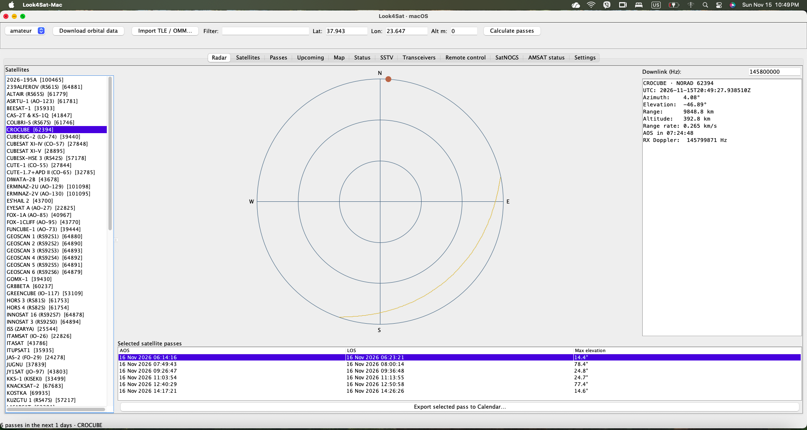

# maclook4sat

**Look4Sat for Intel and Apple Silicon macOS — an unofficial, experimental desktop port of the Android satellite tracker.**

Based on [Look4Sat 4.4.9 by rt-bishop](https://github.com/rt-bishop/Look4Sat). The original project is free and open source under GPL-3.0. This macOS adaptation is maintained independently by [z1000biker](https://github.com/z1000biker).



*Look4Sat-Mac PoC running on Intel macOS (screenshot from 15 November 2026, before the optional external Compass tab). This demonstrates the application UI, not full functional or stability validation.*

## Current preview: optional external Compass (Intel and Apple Silicon)

The [optional Compass preview release](https://github.com/z1000biker/maclook4sat/releases/tag/v4.4.9-macos-compass-poc) includes freshly compiled **Intel x86_64** and **Apple Silicon arm64** application archives. Both macOS GitHub Actions jobs passed source compilation, desktop offline verification (including compass parsing and TCP loopback), and app packaging in [build run #43769376693](https://github.com/z1000biker/maclook4sat/actions/runs/43769376693).

| Platform | Compass preview download | Verification |
| --- | --- | --- |
| Intel Mac (`x86_64`) | [Compass Intel CI ZIP](https://github.com/z1000biker/maclook4sat/releases/download/v4.4.9-macos-compass-poc/Look4Sat-Mac-4.4.9-Compass-Intel-CI-UNTESTED.zip) | Compilation and offline checks passed; **not tested on real Mac or compass hardware** |
| Apple Silicon Mac (`arm64`) | [Compass Apple Silicon CI ZIP](https://github.com/z1000biker/maclook4sat/releases/download/v4.4.9-macos-compass-poc/Look4Sat-Mac-4.4.9-Compass-AppleSilicon-CI-UNTESTED.zip) | Compilation and offline checks passed; **not tested on real Apple Silicon Mac or compass hardware** |
| Intel user-packaged build (`x86_64`) | [Compass Intel user build ZIP](https://github.com/z1000biker/maclook4sat/releases/download/v4.4.9-macos-compass-poc/Look4Sat-Mac-4.4.9-Compass-Intel-user-build-UNTESTED.zip) | Supplied macOS app archive; **not independently tested** |
| Full source archive | [Compass full source ZIP](https://github.com/z1000biker/maclook4sat/releases/download/v4.4.9-macos-compass-poc/Look4Sat-Mac-4.4.9-Compass-full-source.zip) | Original Look4Sat 4.4.9 source tree plus the macOS Compass additions and packaging fix |

**UNTESTED PREVIEW:** GitHub Actions success demonstrates compilation and automated checks, not real-world execution, serial/Bluetooth connectivity, antenna pointing accuracy, or overall stability. The earlier [non-Compass PoC release](https://github.com/z1000biker/maclook4sat/releases/tag/v4.4.9-macos-poc) is retained separately. The original desktop PoC was shown running on an Intel Mac; the new Compass feature has **not** been tested with real sensor hardware.

> [!WARNING]
> **Development proof of concept — not production-ready.** The app has launched on an Intel Mac, but complete feature parity and stability have **not** been established. A system restart was reported while testing an earlier satellite switch. Use at your own risk and save other work before testing.

## Download and install

Get the latest experimental Compass build from the [Compass prerelease](https://github.com/z1000biker/maclook4sat/releases/tag/v4.4.9-macos-compass-poc). Select the archive that matches your Mac’s processor. The older [v4.4.9 macOS PoC release](https://github.com/z1000biker/maclook4sat/releases/tag/v4.4.9-macos-poc) remains available for comparison, including its earlier Intel and Apple Silicon CI builds and source.

1. Download the appropriate Intel or Apple Silicon ZIP from the Compass prerelease.
2. Unzip it and optionally move `Look4Sat-Mac.app` into `/Applications`.
3. Launch the application through Finder. If macOS blocks an unnotarized app, verify its source before considering **Privacy & Security → Open Anyway**.
4. Enter your observer latitude, longitude and altitude, then download orbital data or import TLE/OMM files.
5. To use a separate orientation sensor, open the optional **Compass** tab and configure the transport, data format and mounting corrections. Compass is **disabled by default**.

The packaged app contains its own Java runtime (`Contents/runtime/`); users do not need a separate Java installation merely to launch it. The builds are **ad-hoc signed, not Apple Developer ID signed or Apple-notarized**. Real Mac runtime support and external sensor connectivity remain unverified for these new builds.

## What is implemented?

The desktop PoC presents the following areas. A visible tab does **not** imply that the feature is fully functional:

| Area | Current status |
| --- | --- |
| Radar / satellite position | North-up by default; experimental radar rotation and pointing guidance when a fresh **external** Compass reading is available |
| External Compass (optional) | Serial or TCP CSV/JSON heading/tilt stream; mounting offsets, magnetic declination, inversion and stale-data fallback; **not tested with real hardware** |
| Satellite list and NORAD selection | UI demonstrated; repeat satellite-switch stability not established |
| Pass predictions / upcoming passes | UI demonstrated; further accuracy testing needed |
| Map and ground track | Implemented as experimental desktop UI |
| Status and station settings | Implemented as experimental desktop UI |
| SSTV | Experimental audio/decoder integration; device testing incomplete |
| Transceivers / CAT control | Experimental; real-radio testing incomplete |
| Rotator control | **Not implemented in the current macOS port**; do not assume Android rotator integration is available |
| Remote control | Experimental; not independently validated |
| SatNOGS / AMSAT status | Experimental; network data and feature coverage need verification |

The orbit calculation code is derived from the original Look4Sat engine. The macOS user interface is a separate Kotlin/JVM desktop implementation, rather than the original Android interface running natively.

## Compass, radar orientation and manual antenna pointing

**The Mac does not use its own accelerometer or electronic compass for pointing.** The radar remains north-up unless the user explicitly enables the new external **Compass** tab and sends it valid, recent orientation readings from a separate sensor or controller. Rotating or tilting the Mac itself does **not** change the radar. The phone-style Android orientation-sensor experience has not been ported.

The optional external Compass tab accepts **one reading per line** over a macOS serial device such as `/dev/cu.usbserial*` or a **TCP connection** to a configured host and port. Choose CSV or JSON, select the heading field and optionally the pitch/tilt field, then apply the settings to connect. For example:

```text
CSV: 123.4,15.0
JSON: {"heading":123.4,"pitch":15.0}
```

CSV columns are numbered from 1; JSON fields are configurable by name (defaults `heading` and `pitch`). Heading and tilt are in degrees, with **positive pitch upward**. If your sensor measures magnetic heading, enter the local **magnetic declination** (east positive) to convert to true heading; set declination to zero if your source already reports true heading. There are also corrections for the sensor’s mounting-heading offset and pitch offset, plus a pitch-inversion checkbox. If tilt is unavailable, leave its field blank and use heading-only input.

When valid live sensor data arrives, the radar rotates and the interface displays pointing guidance relative to the selected satellite. If Compass is disabled, disconnected or the input becomes stale, the display safely returns to **north-up**. The new input parser and TCP loopback behavior passed automated tests, but **real serial devices, external electronic compasses, physical mounting calibration and antenna-pointing accuracy have not yet been tested**. TCP data is not inherently authenticated or encrypted; use a trusted local network, not an exposed internet port.

For manual antenna pointing without external orientation data, use the displayed satellite **azimuth and elevation** with a separate compass and elevation scale/inclinometer. An accelerometer by itself measures tilt relative to gravity but cannot determine north. The satellite pass predictions, ground tracks, receive-frequency Doppler estimates, experimental CAT radio support and SSTV interface remain available independently of this Compass option. **Automated rotator control has not been implemented or verified in this macOS port.**

## Build from source

Clone this repository (recommended for the latest Compass source) or download the [full Compass source archive](https://github.com/z1000biker/maclook4sat/releases/download/v4.4.9-macos-compass-poc/Look4Sat-Mac-4.4.9-Compass-full-source.zip). On a Mac with **JDK 21** installed, from the repository directory or extracted source directory:

```bash
cd desktop-macos
./gradlew verifyDesktop
./gradlew run
./gradlew packageMac
```

The packaged application is expected under `desktop-macos/build/macos/Look4Sat-Mac.app`. `packageMac` invokes the JDK's `jpackage` and performs ad-hoc macOS signing. It is not equivalent to an Apple Developer ID signature or notarization.

The desktop Gradle project uses Kotlin/JVM 2.4.21 and JDK 21. It reuses portions of `core/domain` and CAT protocol sources from the original repository, so **retain the complete extracted source tree** when building.

## Limitations and reporting

- Treat unexpected crashes, incorrect pass data, satellite-switching issues and USB/serial device problems as possible.
- The ZIP archives passed integrity checks, but passing a ZIP integrity check does **not** certify application stability.
- When reporting a problem, include macOS version, Mac CPU architecture, selected satellite/NORAD ID, action sequence and relevant app logs. For Compass issues, describe serial/TCP transport, sensor output example and calibration values—without passwords or tokens.
- Report issues in [GitHub Issues](https://github.com/z1000biker/maclook4sat/issues).

## Credits and license

Original project: [rt-bishop/Look4Sat](https://github.com/rt-bishop/Look4Sat), licensed under **GNU General Public License v3.0**. This repository is an **unofficial independent port**, not an endorsed upstream release. The source archive preserves original notices and the GPL license; see [LICENSE](LICENSE).
